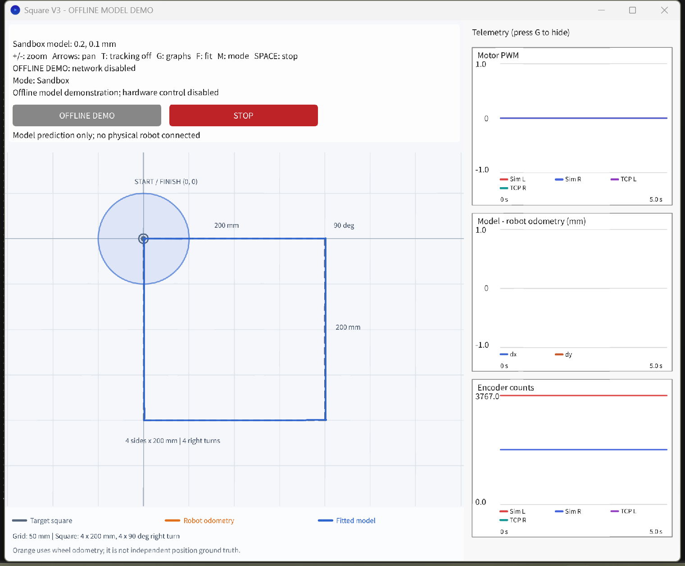

# 机器人小车数字孪生 / Robot Car Digital Twin

基于编码器反馈的机器人小车与独立的 Processing 数字孪生，目标路线为**每边 200 mm 的顺时针正方形**。用于布里斯托大学 Robotics Science & Systems（SEMTM0043/SEMTM42）小组项目。

An encoder-controlled robot car and an independent Processing digital twin for a **clockwise square with 200 mm sides**, developed for group work in University of Bristol Robotics Science & Systems (SEMTM0043/SEMTM42).

[中文详细说明 / Chinese setup guide](README_先看这里.md) · [英文技术概述 / English overview](OVERVIEW_EN.md) · [致谢 / Acknowledgements](ACKNOWLEDGEMENTS.md) · [环境依赖 / Dependencies](DEPENDENCIES.md) · [实机验证方法 / Physical validation](PHYSICAL_VALIDATION.md)



## 快速开始：离线演示 / Quick start: offline demo

1. **下载并解压 / Download and extract**：点击 **Code → Download ZIP**，完整解压仓库。<br>
   Select **Code → Download ZIP** and extract the entire repository.
2. **安装环境 / Install dependencies**：安装 **Processing 4.5.7**，包含其自带 Java 运行环境和 Network 库。<br>
   Install **Processing 4.5.7** with its bundled Java runtime and Network library.
3. **启动演示 / Launch the demo**：Windows 下双击 **RUN_DEMO.bat**。该模式只计算模型运动，禁用网络连接和实机控制。<br>
   On Windows, double-click **RUN_DEMO.bat**. This mode computes model motion with networking and hardware control disabled.

如果 Processing 安装在其他位置，可在项目根目录运行以下命令，并修改安装路径：

For a nonstandard Processing installation, run this command from the project root and replace the installation path:

```powershell
powershell -NoProfile -ExecutionPolicy Bypass -File .\tools\Run-Twin.ps1 -ProcessingHome "C:\Path\To\Processing"
```

预编译 Java 类需要 **Java 17 或更高版本**及 Processing 库，配套源码已包含。修改源码后，用 `tools/Build-Twin.ps1` 重新编译，或在 Processing 中打开 `robot-programs/DigitalTwin_LPath/DigitalTwin_LPath.pde`。直接运行源码默认进入 Live 模式，仍需配对并明确点击 START 才会请求实机运动。

The prebuilt Java classes require **Java 17 or later** and the Processing libraries; matching source is included. After editing source, rebuild with `tools/Build-Twin.ps1`, or open `robot-programs/DigitalTwin_LPath/DigitalTwin_LPath.pde` in Processing. Running source directly defaults to Live mode, which still requires pairing and an explicit START before requesting physical motion.

## 项目功能 / Project features

| 功能 / Feature | 中文说明 | English summary |
|---|---|---|
| 小车控制 / Robot control | StampC3 通过课程接口控制小车；四条直线、四次右转；左右轮调速，方向以起始朝向为参照 | StampC3 control through the course interface; four sides and four right turns, per-wheel feedback and run-referenced headings |
| 独立模型 / Independent model | 区分左右轮响应，分别建模通电响应与停机滑行，独立计算控制命令和里程计 | Directional motor gains, separate driven/zero-command dynamics, an independent controller and differential-drive odometry |
| 实时对照 / Live comparison | Wi-Fi/TCP 认证启停、设备时间对齐、CSV 记录、轨迹对照、断连与心跳超时停车 | Authenticated Wi-Fi/TCP START/STOP, device-clock pacing, CSV recording, trace comparison and disconnect/heartbeat stopping |
| 数据分析 / Evidence | 历史 V2 编码器数据、逐路段误差分析、参数拟合与验证记录 | Historical V2 encoder data, stage-by-stage diagnosis, parameter fitting and verification records |

## 文件结构 / Repository structure

| 路径 / Path | 中文用途 | English purpose |
|---|---|---|
| `robot-programs/StampC3_LPath/` | 完整固件源码；在 `RobotSharedConfig.h` 中设置自己的小车配置 | Complete firmware source; configure your robot in `RobotSharedConfig.h` |
| `robot-programs/DigitalTwin_LPath/` | 完整 Processing 源码；保留历史 LPath 文件夹名，当前路线为正方形 | Complete Processing source; historical folder name, current square route |
| `tools/` | Windows 启动和编译脚本 | Portable Windows launch/build scripts |
| `analysis/` | 参数拟合、USB 配对、软件检查 | Calibration, USB pairing and software checks |
| `knowledge-base/square-corner-fix-20261112/` | 冻结的 V2 数据和误差诊断 | Frozen V2 data and diagnosis |
| `app/classes/`、`app/source/` | 预编译 Java 类及配套生成源码 | Prebuilt Java classes and matching generated source |

## 连接自己的小车 / Connect your own robot

1. 在 `RobotSharedConfig.h` 设置自己的热点名称、密码和 mDNS 名称，参照[详细配置说明](README_先看这里.md#用你自己的小车运行)。<br>
   Set your own hotspot name/password and mDNS name in `RobotSharedConfig.h`; follow the [detailed setup guide](README_先看这里.md#用你自己的小车运行).
2. 将固件烧录到 **StampC3**，通过 USB 做本地配对，再配置小车的 Wi-Fi 网络。每台车使用自己的配对密钥，并单独验证参数。<br>
   Flash the **StampC3**, pair locally over USB, then configure its Wi-Fi profiles. Each robot needs its own pairing key and parameter validation.
3. 确保电脑和小车在允许设备互访的同一局域网。配置完成后使用 **RUN_LIVE.bat**。本仓库不包含发送者的网络密码或私人控制密钥。<br>
   Ensure PC and robot share a network that allows peer access. Use **RUN_LIVE.bat** after setup. Sender Wi-Fi passwords and private control keys are excluded.
4. 烧录和配对时稳固支撑小车、让驱动轮悬空；落地试跑时使用平整开阔区域，并明确点击 START。**STOP、空格、Esc** 请求停车。<br>
   Support the robot with its drive wheels clear during upload/pairing. Use a clear level area for physical runs and deliberately click START. **STOP, Space and Esc** request stopping.

一次只使用一个 TCP 客户端。 / Use one TCP client at a time.

## 三条线分别是什么 / What the three lines mean

| 颜色 / Colour | 中文含义 | English meaning |
|---|---|---|
| 灰色虚线 / Grey dashed | 理想的正方形目标路线 | Ideal requested square |
| 蓝色 / Blue | 独立模型预测的路线 | Independent model prediction |
| 橙色 / Orange | 根据实机轮子编码器推算的位置轨迹 | Position estimated from robot wheel encoders |

**橙色里程计轨迹不是独立测得的真实位置。** 打滑或轮径、轮间距参数不准时，轨迹即使重合，也可能偏离实机路线。需要用尺量参照和固定俯拍进行验证，见 [PHYSICAL_VALIDATION.md](PHYSICAL_VALIDATION.md)。

**Wheel odometry is not independent physical ground truth.** Slip or incorrect rolling geometry can make the estimate wrong even when the plotted paths agree. Validate physical motion using measured references and fixed overhead video; see [PHYSICAL_VALIDATION.md](PHYSICAL_VALIDATION.md).

## 离线评估改进 / Improved offline evaluation

新工具可分别记录**小车停车时的同时间差距**与**模型独立完成后的时间、终点和航向差距**，便于区分阶段进度差异和各自完成时的偏差。用户提供的原始改进包保存在 `acknowledgements/DigitalTwin_OfflineEvaluation/`，原交接说明署名 Yanxin Luo。使用方法与指标定义见[中英双语离线评估说明](docs/OFFLINE_EVALUATION.md)。

The new tool separates the **same-time gap at robot stopping** from **time, endpoint and heading differences at respective completion**, helping distinguish route-phase mismatch from completion discrepancies. The original handoff is preserved in `acknowledgements/DigitalTwin_OfflineEvaluation/`; its handoff credits Yanxin Luo. See the [bilingual offline evaluation guide](docs/OFFLINE_EVALUATION.md) for usage and metric definitions.

```powershell
powershell -NoProfile -ExecutionPolicy Bypass -File .\tools\Evaluate-Offline.ps1 -Telemetry .\knowledge-base\square-corner-fix-20261112\source_square_v2.csv
```

该示例使用历史 V2 数据运行当前 V3 模型，仅检查文件评估流程；不能当成 V3 实机预测精度的验证。新工具只读文件，不连接小车；旧的三参数回放接口仍保留。

This example evaluates historical V2 data with the current V3 model as a pipeline check, not validation of V3 physical prediction accuracy. The tool reads files without connecting to hardware, and the old three-argument replay interface remains available.

## 黑白地图与传感器定位方案 / Reflectance landmark-map proposal

计划用已知位置的黑白地标，将底部反射传感器实验接入正方形路径和数字孪生：先记录标记事件，再验证是否能改善位置估计。**目前只有打印地图和实验方案，V3固件尚未实现标记识别或位置修正。**

The proposal links reflectance-sensor experiments to the square-path digital twin using known black/white landmarks: log events first, then test whether they improve position estimation. **Printable maps and an experiment plan are available; V3 firmware does not yet implement marker detection or position correction.**

- **有A3打印机：一张A3横向，420 × 297 mm。 / A3 printer: one landscape A3 sheet.** [打印A3地图 / Print A3 map](maps/landmark_map_v1/Square_Landmarks_A3_100percent.pdf)
- **只有A4打印机：四张A4横向拼接。 / A4 printer: four landscape A4 tiles.** [打印A4拼接版 / Print A4 tiles](maps/landmark_map_v1/Square_Landmarks_A4_4tiles_100percent.pdf)

选择**实际大小 / Actual size / 100%**，不要缩放；打印后量右侧100 mm刻度。正方形边长200 mm。 / Print at **Actual size / 100%**, without scaling, then measure the 100 mm scale. Square sides are 200 mm.

[中英双语方案、摆放与打印说明 / Bilingual proposal, setup and printing guide](maps/landmark_map_v1/README.md)

## 已完成的验证与限制 / Validation status and limitations

发送者已验证固件与完整桌面程序编译、固件烧录、待机数据接收、认证后的非启动 TCP 检查，以及软件测试。分享版还验证了共享配置固件编译、完整桌面编译、离线窗口启动、未配对时阻止 Live 启动，以及解压到含中文和空格的路径后启动。详见 [PACKAGE_VALIDATION.json](PACKAGE_VALIDATION.json)。

The sender verified firmware/whole-sketch compilation, upload, idle telemetry, authenticated non-start TCP integration and software checks. The share edition additionally passed its firmware build, complete desktop build, offline GUI launch, unpaired-live blocking and launch after extraction to a path containing spaces and Chinese characters. See [PACKAGE_VALIDATION.json](PACKAGE_VALIDATION.json).

历史 V2 参数拟合使用第 1、4 轮，第 5 轮未参与参数拟合。第 5 轮相对轮式里程计的全程位置 RMSE 从 **58.06 mm 降至 9.15 mm**，但停车时终点偏差没有改善。第 5 轮在诊断时已被查看，因此不是盲测。这些结果评价历史模型与里程计的一致程度；**V3 实机精度仍需新一轮独立位置和方向测量来验证**。

Historical V2 fitting used trials 1 and 4 and excluded trial 5 from parameter fitting. Trial 5's position RMSE relative to wheel odometry decreased from **58.06 to 9.15 mm**, while stopping-frame endpoint discrepancy did not improve. Trial 5 was inspected during diagnosis, so this was not blind validation. These results measure historical model-versus-odometry agreement; **physical V3 accuracy still requires new independent distance/heading measurements**.


## 致谢 / Acknowledgements

感谢 **Yanxin Luo** 分享数字孪生离线评估脚本与说明，帮助我们更清楚地比较小车与模型的运行时间、终点和方向差异。

Thank you to **Yanxin Luo** for sharing the offline digital-twin evaluator and guidance, helping us compare robot/model timing, endpoints and headings more clearly.

感谢 **miaoyuwang** 分享最初的 **StampC3_SquareBenchmark** 工程，为正方形路径、编码器里程计和 Wi-Fi 数据记录提供了起始参考。

Thank you to **miaoyuwang** for sharing the initial **StampC3_SquareBenchmark** project as a starting reference for square-path motion, encoder odometry and Wi-Fi data recording.

更多致谢与相关资料见 [ACKNOWLEDGEMENTS.md](ACKNOWLEDGEMENTS.md)。

See [ACKNOWLEDGEMENTS.md](ACKNOWLEDGEMENTS.md) for further thanks and related material.

## 来源与许可证 / Provenance and license

本项目包含课程接口、组员提供的基准程序，以及本人后续完成的本地集成、模型与控制修改。详见 [SOURCES_AND_CHANGES.md](SOURCES_AND_CHANGES.md)，并保留课程源码的 [GPL-3.0 许可证](LICENSE)。Processing、Java、ESP32 等第三方运行环境需单独安装。

This snapshot combines course interfaces, a teammate-supplied benchmark and Zeqi Dong's subsequent local integration/model/control work. See [SOURCES_AND_CHANGES.md](SOURCES_AND_CHANGES.md) and the preserved [course GPL-3.0 license](LICENSE). Third-party Processing, Java and ESP32 runtimes are installed separately.

`SHARE_PACKAGE_MANIFEST.sha256` 保留原分享压缩包的文件校验值；GitHub 版的首页、许可证位置和 Git 配置是后续整理内容。

`SHARE_PACKAGE_MANIFEST.sha256` preserves checksums of the original team-share package; the GitHub README, license placement and Git configuration are later packaging additions.
