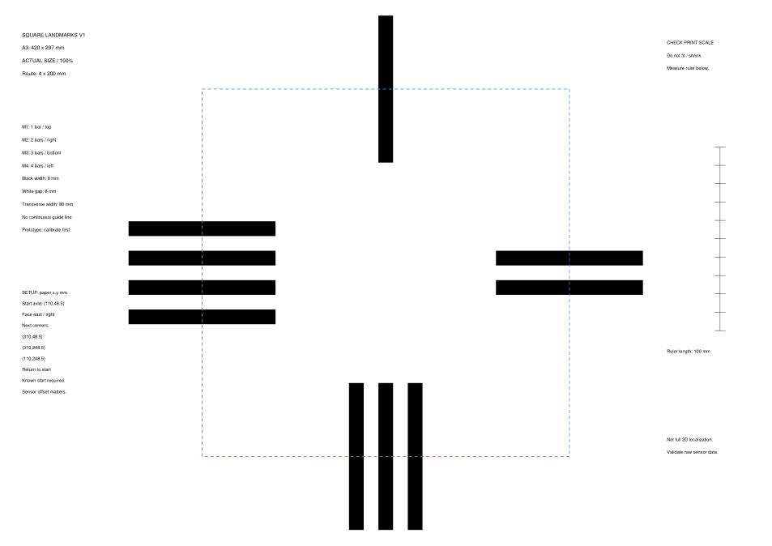

# 黑白地标辅助定位 / Black-and-white landmark-assisted localization

这是把个人底部反射传感器实验接入小组数字孪生项目的第一版方案和打印地图。**当前状态：可打印的实验原型；V3 固件尚未实现标记读取、识别或位置修正。**

This is a first map/proposal linking the individual reflectance-sensor experiments to the group digital-twin project. **Status: printable experimental prototype; V3 firmware does not yet read/decode these markers or apply position corrections.**

## 打印哪一个 / Which file to print

| 打印条件 / Printer | 文件 / File | 纸张 / Paper |
|---|---|---|
| 有 A3 打印机 / A3 available | [A3 整张地图 / Full map](Square_Landmarks_A3_100percent.pdf) | **一张 A3 横向 / One landscape A3 sheet, 420 × 297 mm** |
| 只有 A4 打印机 / A4 only | [A4 拼接地图 / Tiled map](Square_Landmarks_A4_4tiles_100percent.pdf) | **四张 A4 横向 / Four landscape A4 sheets, each 297 × 210 mm** |

两者选择其一。选择**实际大小 / Actual size / 100%**，关闭 Fit、Shrink 和适应纸张。不要将整张 A3 文件直接缩印为一张 A4。打印后，用尺子核对地图右侧的 **100 mm** 刻度；只有实物测量才能确认打印机没有缩放。

Choose one version. Print at **Actual size / 100%**, with Fit/Shrink disabled. Do not shrink the full A3 map onto one A4 sheet. Measure the printed **100 mm** scale on the right; physical measurement is required to verify the printer's scaling.

A4 版按页头的左上、右上、左下、右下位置拼接，对齐 **20 mm 重叠区**的图形，裁掉外侧页边；胶带贴背面，保持纸面平整。拼接完成后的地图尺寸仍为 420 × 297 mm。

For A4, assemble the labelled top-left, top-right, bottom-left and bottom-right tiles. Align the common graphics in their **20 mm overlap**, trim page margins and tape the reverse side. Keep the surface flat. The assembled map is still 420 × 297 mm.

## 摆放与标记 / Setup and markers

路线为每边 **200 mm** 的顺时针正方形。纸面坐标以左上角为原点，x 向右、y 向下。起始车轴中点放在 **(110, 48.5) mm**，车头向右。依次经过 (310,48.5)、(310,248.5)、(110,248.5)，返回起点。PNG 仅用于参考摆放，打印使用 PDF。

The route is a clockwise square with **200 mm sides**. Paper coordinates start at the top-left, with x rightwards and y downwards. Place the starting axle midpoint at **(110,48.5) mm**, facing right. Visit (310,48.5), (310,248.5), (110,248.5), then return. Use the PNG for setup reference and the PDFs for printing.

| 标记 / Marker | 黑条数 / Bars | 所在边 / Side | 标记组中心：小车世界坐标 / Group centre in robot world frame, mm |
|---|---:|---|---|
| M1 | 1 | 上边 / Top | (100, 0) |
| M2 | 2 | 右边 / Right | (200, -100) |
| M3 | 3 | 下边 / Bottom | (100, -200) |
| M4 | 4 | 左边 / Left | (0, -100) |

每根黑条沿行进方向宽 **8 mm**，白色间隔 **8 mm**，横向长度 **80 mm**。位置元数据见 [landmarks.json](landmarks.json)。这些坐标指的是标记组中心，并不等于读到某个黑边或识别完整组时的车轴位置。

Each black bar is **8 mm** wide along travel, with an **8 mm** white gap and **80 mm** transverse length. See [landmarks.json](landmarks.json). Coordinates refer to marker-group centres, not automatically to axle position at a detected edge or after decoding the whole group.

## 接下来怎样接入 / Proposed implementation

1. **先采样 / First log readings:** 测量实际探头高度及相对车轴的偏移，验证纸面黑白响应。个人实验记录为15 mm高度，运行条件下需重新核对。 / Measure actual sensor height and axle-relative offset, then validate black/white response. The individual experiment recorded 15 mm height; check the running configuration again.
2. **再识别 / Then decode:** 先用中间底部探头记录黑白变化；走完整组后，结合起点、路段、条宽和编码器距离识别 M1–M4。 / Start with the central bottom sensor; decode a full group using the known start, route stage, bar widths and encoder distance.
3. **仅作记录 / Log without correction first:** 保留原编码器位置及标记事件，核对漏条、误识别和重复识别。 / Preserve raw odometry and landmark events, checking missed, false and duplicate detections before changing position estimates.
4. **加入观测模型 / Add a measurement model:** 将纸面坐标转换到起始世界坐标，并计入探头偏移和识别延迟，再考虑沿行进方向的位置修正。 / Transform paper coordinates into the start-based world frame, account for sensor offset and decoding delay, then consider along-track corrections.
5. **对照实验 / Compare:** 用相同地图比较纯编码器与加入标记观测的运行，分别保存原始和修正后的估计，并用独立尺量或俯拍验证。 / Compare encoder-only and marker-assisted runs, preserve raw/corrected estimates separately and validate with independent measurements or overhead video.

现有13列遥测没有反射传感器读数；需增加专用采样/日志通道。建议将本地100 Hz作为待验证的初始采样设置，并根据实际速度、8 mm条宽及观测质量检查是否足够，而不是直接依赖约50 ms的现有遥测。

The existing 13-column telemetry has no reflectance readings; a dedicated sampling/logging channel is needed. Local 100 Hz sampling is a proposed starting setting to validate against actual speed, 8 mm bar widths and observation quality, rather than relying directly on the existing roughly 50 ms telemetry.

## 能得到什么位置约束 / What the observations constrain

黑白读数和重复条纹本身没有唯一二维坐标；条数编码也不提供方向。当前方案需要已知起点和路线先验。一次横向条带观测主要约束沿行进方向的位置，不能单独恢复完整的 x、y 和朝向。漏条、打滑、打印材料、光照和纸面接缝都会影响效果。

Black/white readings and repeated bars do not uniquely identify a 2D pose; bar counts do not supply direction. This design assumes a known start and route prior. A transverse stripe observation mainly constrains along-track position and does not independently recover x, y and heading. Missed bars, slip, printing materials, lighting and paper joins can affect results.

用于修正的同一地图标记不能同时作为完全独立的精度真值；模型或修正轨迹变得更方正，也不等于实机更准确。此方案尚无实机识别或定位精度结果。

Markers used for correction are not simultaneously independent accuracy ground truth. A more square model/corrected trace does not prove more accurate physical motion. This prototype has no established hardware detection or localization accuracy results.

方法背景 / Background: Ben-Ari & Mondada, *Elements of Robotics*, [Chapter 8: Localization](https://doi.org/10.1007/978-3-319-62533-1_8).

重新生成地图 / Regenerate maps: `python analysis/create_landmark_map.py` (optional dependencies: `reportlab`, `PyMuPDF`).
